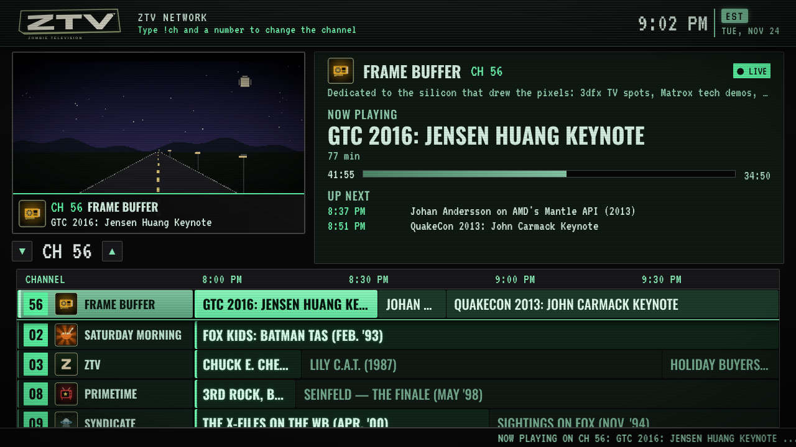
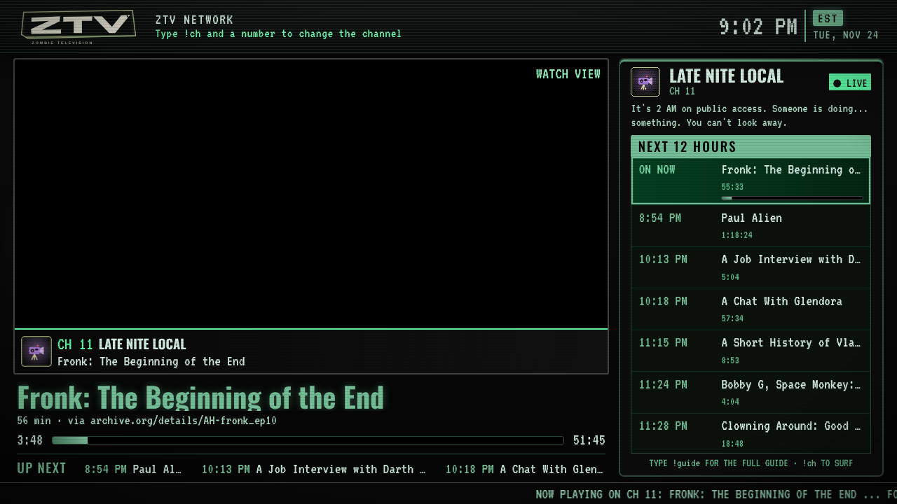
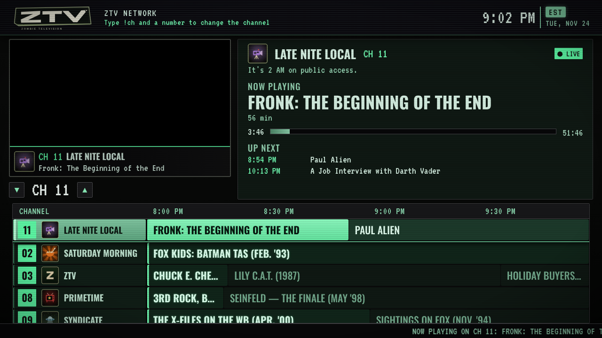
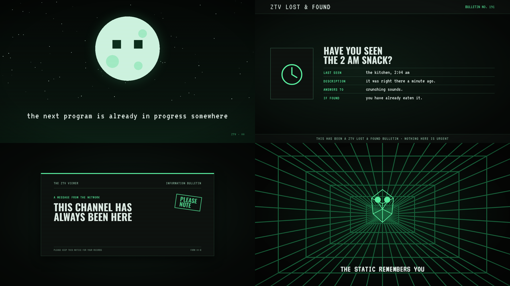
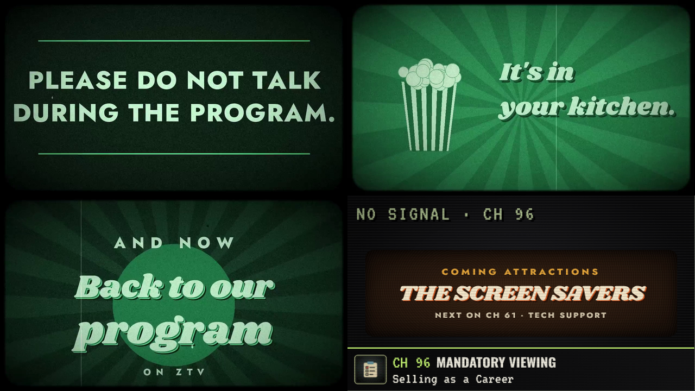
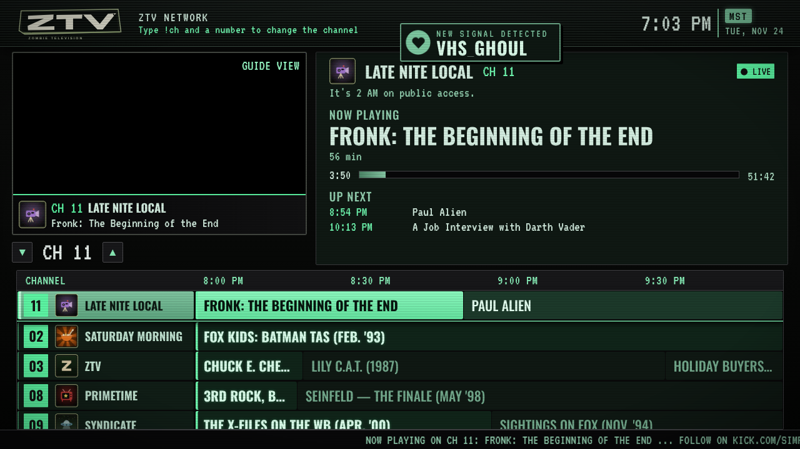
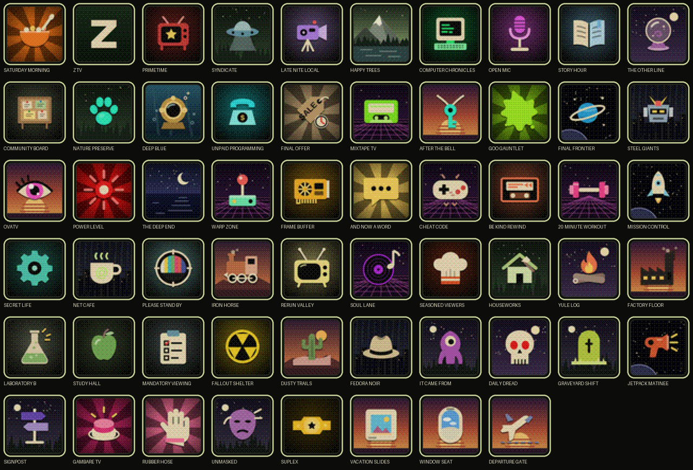

# ZTV on Kick

ZTV is a 24/7 retro cable channel that streams to [kick.com/simplezombie](https://kick.com/simplezombie).
It's a web page that looks like an old cable box guide, plays forgotten videos from the Internet Archive
on about 60 themed channels, and lets Kick chat change the channel, vote, request shows and more.
A small Linux server opens the page in Chrome and streams it to Kick around the clock.

Every channel runs on a fixed schedule, so everyone watching sees the same show at the same time.

> **Status: retired (Nov 2026).** ZTV ran on Kick in November 2026 until Kick objected to a channel that streams 24/7, so it's no longer live. The code is kept here as it was on its last day. Everything still runs locally: open the page in a browser to see it.

## Screenshots

| | |
|---|---|
|  |  |
| **Watch view** (`!fullscreen`) | **Late night** after midnight |
|  |  |
| **Takeovers** | **Pre-roll bumpers** and the Coming Attractions card |
|  |  |
| **Follow alert** | **Channel icons** |

*The TV window in the guide shot is playing one of ZTV's own bumpers. The archive.org shows themselves aren't in the screenshots.*

## What's in it

- **Channel guide and Watch view.** A scrolling cable guide, plus a big-picture view with the next 12 hours (`!fullscreen`).
- **Kick chat control.** Viewers change channels, surf, vote and request shows. ZTV reads chat without logging in.
- **Alerts.** Follows, subs, gift subs (a big "gift bomb" for 5 or more) and raids.
- **Network extras.** Takeovers (including ZTV Explains, Lost & Found, ZTV Is Your Friend), station IDs, bumpers, ZTV Classifieds ad breaks, a parody ZOMBIE ALERT, the Z Weather break with real forecasts, Viewer's Choice votes, chat text bumps, Z Bucks and a daily recap card.
- **A broadcast day.** A late night look after midnight, dead air at 3 AM, a sign-off at 3:58 AM, and stand-by cards around the daily restarts.

## Try it on your PC

Double-click `Open ZTV (Chrome).bat` or `Open ZTV (Firefox).bat` (Mac: `Open ZTV (Mac).command`).
It opens ZTV full screen in its own window with sound on. You can also open `index.html` in Chrome, but then it waits for a click before playing sound.

Preview keys:

| Key | What it does | Key | What it does |
|---|---|---|---|
| ↑ ↓ / W S | change channel | R | random channel |
| 0–9 | dial a channel number | X | Watch view on/off |
| T | takeover | L | weather break |
| B | bumper | V | Viewer's Choice vote |
| F / U / G | follow / sub / gift alert | J | raid alert |
| A | ad break | Z | zombie alert |
| D | 3 AM dead air | O / I | sign-off / sign-on |
| K | recap card | Y | chat text bump |
| + - M | volume / mute | C | chat status |
| E | edit CH 03 (your own videos) | | |

## Chat commands

**Everyone:**
- `!ch 13` or `!ch mixtape` · `!next` · `!prev` · `!random` · `!surf`
- `!whatson` · `!fullscreen` · `!guide`
- `!vote 2` (during a vote)
- `!request part of a title` · `!queue`
- `!bump your message` (a mod approves it first)
- `!weather 78701` or `!weather Austin, TX`
- `!zb` · `!zbtop` · `!buy ch 12` · `!buy weather` · `!buy takeover`

**Mods and the broadcaster:**
- `!ok 3` / `!no 3` approve or reject a bump
- `!skip` ends a request
- `!givezb name 100`
- `!unmute` · `!mute` · `!vol 80` sound on the stream
- `!startvote` · `!weather` · `!takeover` (or `!takeover explainer`, `missing`, `friend`, `moon`...)
- Tests: `!testfollow` · `!testsub` · `!testgift 10` · `!testraid name 25` · `!ad` · `!alert` · `!deadair` · `!signoff` · `!signon` · `!recap` · `!latenight`

Mods skip the cooldowns.

## Put it on a server (24/7 to Kick)

You need an Ubuntu 24.04 server. **6 CPU cores** is comfortable, because the server plays video and encodes the stream at the same time.
A US Central location works well for Kick.

1. Copy the project up and run setup. From PowerShell on your PC, in the folder with the zip:

       scp ztv-kick.zip root@YOUR.SERVER.IP:
       ssh root@YOUR.SERVER.IP
       apt-get install -y unzip && unzip -o ztv-kick.zip && bash ztv-kick/server/setup.sh

2. Add your Kick stream URL and key (Kick Creator Dashboard → Settings → Stream URL & Key):

       nano /etc/ztv/stream.env
       systemctl restart ztv-stream

   The key never goes in this project. Keep it secret, and if it ever shows up on screen, reset it on Kick.

3. Turn on chat and follow alerts. Open `https://kick.com/api/v2/channels/YOURNAME`.
   Put the `"chatroom":{"id":...}` number in `data/kick.js` as `chatroomId`, and the very first `"id"` as `channelId`. Then run setup again.

### Updating

Copy the new zip up, then on the server:

    unzip -o ztv-sync.zip && bash ztv-kick/server/setup.sh

### Useful server commands

| Command | What it does |
|---|---|
| `systemctl status ztv-stream` | is it running |
| `journalctl -u ztv-stream -f` | watch the log |
| `journalctl -u ztv-stream --since "-5 min" \| grep health` | encoder health (speed ≈ 1x, dropped ≈ 0) |
| `bash ztv-kick/server/ztv-check.sh` | tests the screen grab, audio and encoder separately |
| `systemctl stop ztv-stream` / `systemctl start ztv-stream` | take the stream off the air / bring it back |

Every Sunday at 5 AM Central the server checks every show against archive.org and takes out any that were removed or broke, so viewers don't land on NO SIGNAL. A show has to fail two weeks in a row before it's taken out, and it comes back by itself if it's fixed. To run the check now, or see the last report:

    python3 ztv-kick/server/check-videos.py
    tail -40 /var/log/ztv-check-videos.log

The server restarts the stream at **4 AM, noon and 8 PM Central** to stay fresh.
To change those times, edit `restarts.times` in `data/extras.js` and run setup with the same times:

    RESTART_TIMES="04:00 12:00 20:00" bash ztv-kick/server/setup.sh

## Channels and shows

- `data/channels.js` holds the lineup: number, name, color and description.
- `data/catalog.js` holds the shows for each channel, as `[archive.org id, title, seconds]`.
- `assets/channel-icons/<channel id>.png` holds each channel's icon.

To fill a new or thin channel automatically, add searches for it in `server/fill-catalog.py`, then run on the server:

    python3 ztv-kick/server/fill-catalog.py denpa
    bash ztv-kick/server/setup.sh

The filler saves to `data/catalog-extra.js`, which lives only on the server.
Update zips never include it, so an update can't wipe what it found.
Check what it adds, because archive.org keyword searches can drag in things that don't belong.

## Settings

Almost everything is in `data/extras.js`, and every section can be turned off with `on:false`:
timings for takeovers, ads, weather and votes, Z Bucks prices, cooldowns, the late night hours, the restart times and the ticker text.
Other settings live in their own files:

- `data/takeovers.js`: takeover lines and looks, plus the ZTV Explains, Lost & Found and ZTV Is Your Friend scripts
- `data/bumpers.js`: bumpers, both the text cards and the pixel-art video bumpers in `bumpers/` (made with `tools/video-bumpers/`)
- `data/ads.js`: classifieds listings and fake commercials
- `data/kick.js`: Kick chat

## Project layout

    index.html          the page
    css/style.css       all styles (later rules win, so new overrides go at the bottom)
    js/                 app.js (schedule, guide, player), chat.js (Kick chat), segments.js and takeover.js
                        (full-screen pieces), community.js (bumps, requests, Z Bucks), weather.js, overlays.js,
                        watchview.js, vote.js, buffer.js, audio.js, icons.js
    data/               channels, catalog, settings and text you can edit
    assets/ audio/      channel icons, logos and the original weather theme
    server/             setup.sh, run.sh (the 24/7 pipeline), ztv-check.sh, fill-catalog.py, check-videos.py
    bumpers/            video bumpers
    tools/              video-bumpers/: the scripts that draw them
    docs/CHANGELOG.md   history

## Notes

- All programming streams straight from the Internet Archive and belongs to its uploaders and rights holders. If a rights holder asks, remove the item from `data/catalog.js`.
- ZTV's own art, music, bumpers, ads and on-screen copy are original. The fake commercials and the zombie alert are parodies and are labeled that way on screen.
